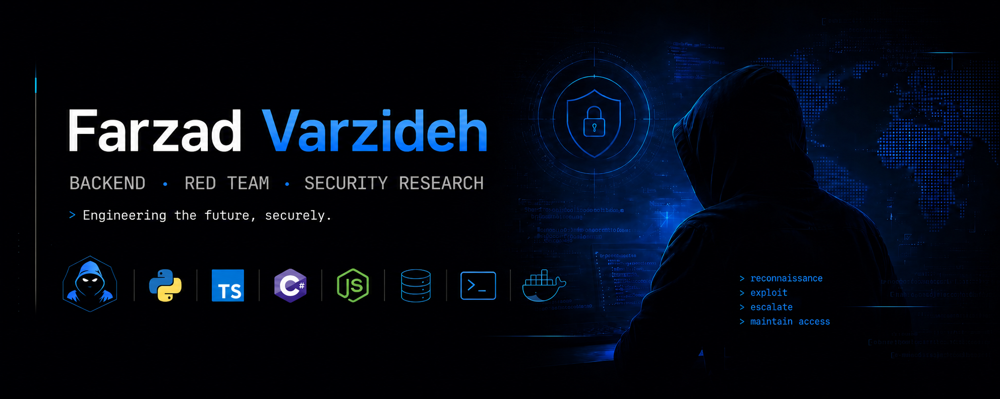
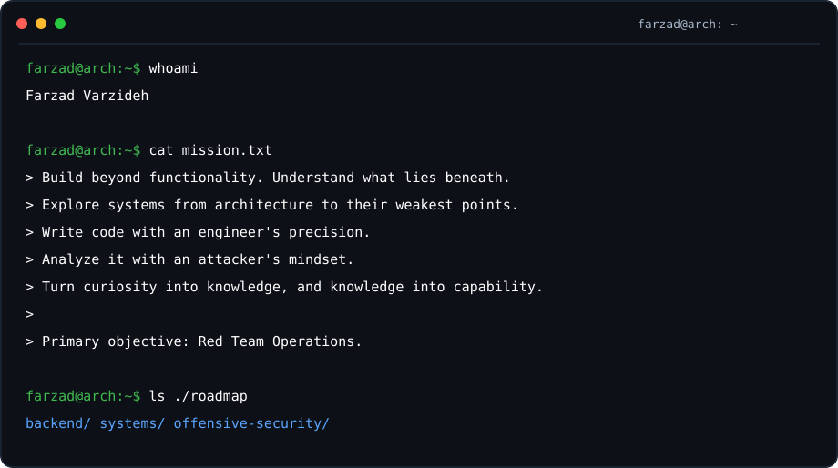
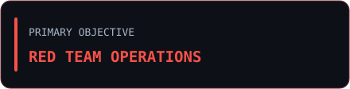
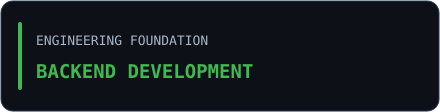
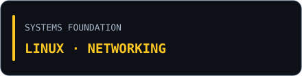
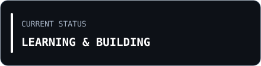
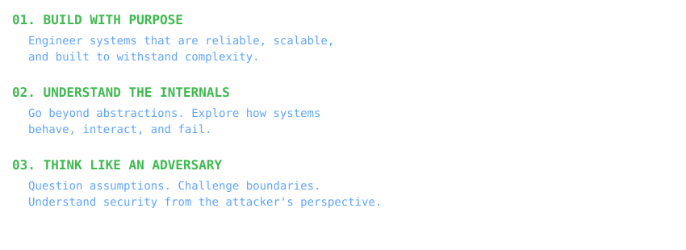

<div align="left">
  
</div>

---


---

### `01 / operator console`

<div align="left">
  
</div>

### `02 / operations dashboard`

|  |  |
|:---|:---|
|  |  |

### `03 / tech arsenal`

**Languages & Scripting**


**Backend & Database**


**Environment & Tooling**


### `04 / next objectives`

```yaml
backend:
  - NestJS
  - Multi-tenancy
  - SQL

systems:
  - Windows
  - Active Directory

offensive_security:
  - PTS
```

### `05 / selected work`

> Projects and experiments will appear here as they are published.

<!-- Add projects here using this template:
**[Project Name](https://github.com/YOUR_USERNAME/REPOSITORY)** — Short description.
-->


### `06 / engineering ethos`



> Curiosity drives exploration. Understanding builds capability.
> 
